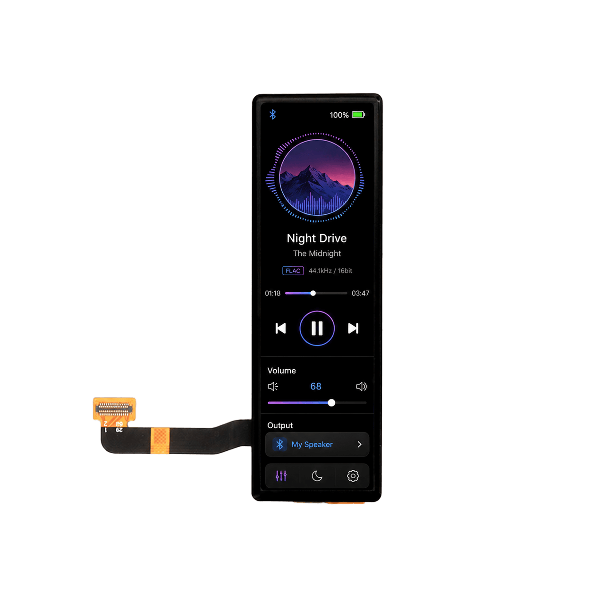

<p align="left"></p>

<h1 align="center">OSPTEK 3.19″ AMOLED 显示屏 262×928（AM319M262928ZS）</h1>

<p align="center"><b>AMOLED 模组 · MIPI · CO6300</b></p>

<p align="center"><a href="./README_EN.md">English</a> | 简体中文 · <a href="../../README.md">规格族索引</a></p>

<p align="center">
  
  
  
</p>

<p align="center"></p>

## 目录

- [规格参数](#规格参数)
- [相关资料](#相关资料)
- [仓库结构](#仓库结构)
- [购买链接](#购买链接)
- [技术支持](#技术支持)

---

## 规格参数

| 项目 | 规格 |
| ---- | ---- |
| 尺寸 | 3.19 英寸 |
| 类型 | AMOLED |
| 分辨率 | 262×928 |
| 外形尺寸 | 26.50 x 82.45 mm |
| 有效显示区域 | 22.008 x 77.952 mm |
| 接口 | MIPI |
| 驱动 IC | CO6300 |
| 触摸驱动 | CST3530 |

> 完整外形尺寸、FPC 定义、供电与时序以产品规格书 / 驱动手册为准。

## 相关资料

| 分类 | 文件 |
| ---- | ---- |
| 规格文档 | [`CO_6300_Datasheet_V0_00_20240827_for_customer_d6da76ca4d.pdf`](./datasheets/CO_6300_Datasheet_V0_00_20240827_for_customer_d6da76ca4d.pdf) |
| 规格文档 | [`CST_3530_V1_0_adb72690f0.pdf`](./datasheets/CST_3530_V1_0_adb72690f0.pdf) |
| 规格文档 | [`AM319M262928ZS.pdf`](./datasheets/AM319M262928ZS.pdf) |
| CAD 图纸 | [`AM319M262928ZS.dwg`](./cad/AM319M262928ZS.dwg) |
| 转接板资料 | [`PNG-1.png`](./adapter/PNG-1.png) |
| 转接板资料 | [`SCH_鱼鹰光电3.19_MIPI_AMOLED转接板V1.0_2025-08-04.pdf`](./adapter/SCH_%E9%B1%BC%E9%B9%B0%E5%85%89%E7%94%B53.19_MIPI_AMOLED%E8%BD%AC%E6%8E%A5%E6%9D%BFV1.0_2025-08-04.pdf) |

## 仓库结构

```text
display-amoled-3.19inch-262x928/ # 仓库根（导航见 ../../README.md，示例工程见根目录 examples/）
└── versions/
    └── AM319M262928ZS/        # 本料号完整资料
        ├── README.md
        ├── README_EN.md
        ├── osptek.yml
        ├── images/
        ├── datasheets/       # 产品规格书 + 驱动/触摸 IC 数据手册
        ├── cad/              # 外形/盖板 CAD
        └── adapter/          # 转接板资料 + 转接板图片
```

## 购买链接

见[仓库首页](../../README.md#购买链接)。

## 技术支持

见[仓库首页](../../README.md#技术支持)。

---

<p align="center"><sub>© 2026 OSPTEK 鱼鹰光电 · 本仓库资料采用 CC BY 4.0 许可</sub></p>
